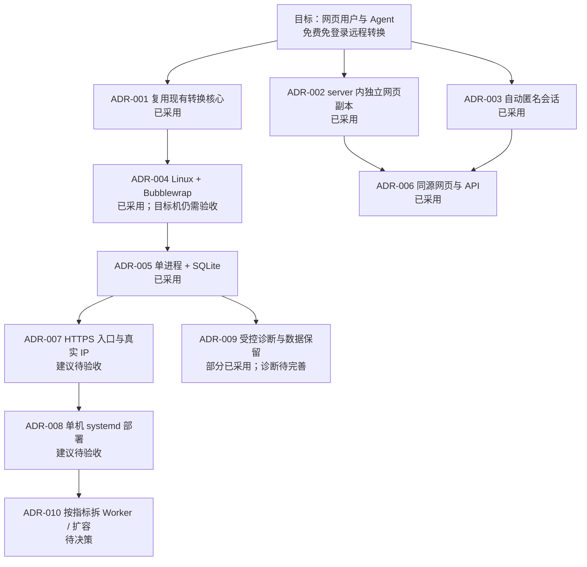

# MD2DOCX 架构决策记录（ADR）

日期：2026-11-06。状态分为「已采用」「建议待验收」「待决策」。ADR 是有背景、有代价的决策记录；图用于展示依赖，不能代替记录本身。

## 决策依赖图

## ADR-001：转换核心与协议复用

- 状态：已采用。
- 背景：已有 CLI、Pandoc、python-docx/OOXML 和配置协议 2。网页与 Agent 应得到相同转换结果。
- 决策：server 调用既有 CLI，继续使用原配置字段；服务器增加严格输入校验，不复制或重写转换核心。
- 代价：核心已知问题会被继承；例如 stripExisting 可能删除年份。警告不是修复，不能把新增网页当作解决了核心缺陷。
- 替代：重写云端转换引擎会造成双实现和结果漂移，当前不采用。
- 复议条件：协议升级、核心不能安全隔离执行，或长期性能证据表明 CLI 启动代价成为瓶颈。

## ADR-002：网页独立放在 server/web

- 状态：已采用，依据用户明确要求。
- 决策：复制必要组件、CSS 和默认配置到 server/web，独立 package.json、锁文件、构建产物；不依赖 desktop 源码目录。
- 代价：修复样式编辑器、更新默认配置时需人工同步审查，存在快照漂移风险。复用来源记录在网页版迁移与验收.md。
- 替代：共用 UI 包有长期维护优势，但会增加本次桌面代码改造范围，当前不采用。
- 验收：desktop/core/cli 无本次迁移修改；网页无 Electron 运行依赖。安装包不应因网页构建而加入服务端依赖，后续打包变更需继续验证。

## ADR-003：免费匿名服务使用自动临时会话

- 状态：已采用。
- 决策：不设登录、收费和人工发 Key；浏览器 HttpOnly Cookie，Agent 临时 Bearer token，服务端存哈希。所有任务操作验证归属。
- 原因：免费不等于任务公开；用户不能凭他人的 jobId 取得文件。
- 代价：清除 Cookie、换浏览器后不能恢复原访问权；匿名会话可重建，不能承担反滥用的全部职责。
- 复议条件：实际需要跨设备恢复时，先讨论可选账户，不在本次静默引入。

## ADR-004：Linux 主机内 Bubblewrap 隔离

- 状态：实现已采用；VMware 转换失败尚未定位，生产兼容性待验收。
- 决策：执行 CLI 和图片解码时使用 Bubblewrap，限制网络、文件挂载、进程和时间；隔离不可用时拒绝任务，不降级为宿主机直接执行。
- 背景：当前有空闲 2 核 2G 服务器；普通 Cloudflare 函数是否适配现有本地子进程链不是既定事实，容器成本也无需在本阶段承担。
- 代价：依赖 Linux namespace、Bubblewrap、系统安全策略；共享宿主内核，不等于完整虚拟机隔离。
- 替代：Docker 或托管容器可重新评估；本 ADR 不宣称其免费额度、价格或性能已完成实时核实。

## ADR-005：单 API worker、内部队列与 SQLite

- 状态：已采用。
- 决策：一个 Uvicorn worker，一个内部执行循环，顺序转换；SQLite WAL 持久状态、限流、幂等和会话；文件锁限制同数据目录单实例。
- 原因：降低小服务器的常驻内存和运维组件数量，控制转换并发。
- 代价：接口与调度共故障域，不能直接横向扩容；图片预处理仍可能与转换重叠。
- 替代：Redis/独立 Worker/数据库服务留待指标驱动，当前不为没有实测证据的负载引入。

## ADR-006：同源网页与 API，资源本地提供

- 状态：已采用。
- 决策：Python 提供构建后的网页；浏览器请求相对 /v1 路径；Node 只用于构建；Swagger 本地资源随构建生成。
- 原因：减少跨域凭证问题，避免 CDN 不通造成文档白屏，Agent 与网页共享契约。
- 代价：首次部署和更新网页要构建；前端快照可能与服务限制不同，以 capabilities 和服务端校验为准。
- 安全约束：精确 Origin；只公开 dist 下指定资源，禁止公开 server/data 或项目根目录。

## ADR-007：公网 HTTPS 入口与真实 IP

- 状态：建议待验收；当前没有上线配置。
- 建议：先在单机 Nginx 终止 TLS，应用绑定回环；可选 Cloudflare 作为后续入口，需重新核对可信代理链与防绕过配置。
- 未解决项：当前 proxy_headers=False，应用看到的是代理 IP。单纯添加 X-Forwarded-For 不会修复；也不能直接信任任意客户端头。
- 上线条件：仅信任指定代理，入口重写而非盲传头；应用按可信规则还原来源；伪造头不能绕过限流；多用户轮询不被误聚合。
- 临时取舍：Nginx 做真实客户端入口限流，应用保留保守全局预算，只适用于受控试运行。正式公开免费服务前必须定稿。

## ADR-008：专用用户、systemd 与可回滚部署

- 状态：建议待实机验收。
- 决策建议：专用普通用户运行服务；独立私有数据目录；systemd 整服务资源上限；明确记录发布 commit、配置、运行依赖版本。
- 代价：ProtectHome、NoNewPrivileges 等组合必须与 Bubblewrap 在目标机验证，不能仅因模板存在就宣称可用。构建与运行阶段分离，服务器运行时不需 Vite 常驻。
- 回滚：先停止入口提交并排空/停止服务，再切回旧代码、配置和兼容环境；数据库变更不得盲目覆盖恢复。
- 后续：完善自动脚本前，手册步骤先作为可审查的操作基线。

## ADR-009：最小保留、私有诊断与错误契约

- 状态：输入清理、结果保留与归属校验已采用；受控诊断待完善。
- 当前：终态清理输入/配置，结果默认 24 小时；公开错误不含原始 stderr；原始 CLI 报告清理。
- 问题：CONVERTER_FAILED 无法区分进程启动、rlimit、安全策略和输出格式问题，运维定位成本高。
- 建议：按 requestId/jobId 记录经过脱敏的阶段、退出码、资源触发类型；如需临时采集 stderr，管理员显式开启、限字节、限时、私有权限、不采集会话凭证，不能直接返回给用户。
- 保留：备份和诊断的实际删除期限需单独定稿，不能用「结果 24 小时」覆盖所有元数据和备份承诺。

## ADR-010：扩容必须由指标触发

- 状态：待决策，不执行。
- 建议顺序：先解决正确性与诊断 → 单机生产保护 → 容量实测 → 独立 Worker → 多实例/对象存储。
- 触发证据：排队等待持续超目标、转换内存峰值导致 OOM、接口被转换负载拖慢、单机磁盘预算无法满足保留期。
- 拆分前提：跨进程任务领取、租约/心跳、取消、幂等、产物归属和过期清理协议先明确。简单增加 workers 不构成正确扩容。
- 决策人：用户确认成本、容量目标和复杂度后再实施。

每次决策变化新增 ADR 或补充「被哪条记录取代」，保留历史背景，不把建议状态直接改写成已经上线。

## 平台比较核对（2026-11-06）

Cloudflare 官方资料核对：Python Workers 使用 Pyodide/CPython WebAssembly 与 V8 isolate；现有 Linux CLI、Pandoc 和 Bubblewrap 执行模型不能原样迁移。Workers Free 为 100,000 请求/日、10 ms CPU/次、128 MB/isolate；付费不会使 isolate 变成通用 Linux 主机。Pages Functions 采用 Workers 计费。

Containers 需要 Workers Paid（最低 $5/月），包含额度与超额资源价格见 presentation/来源与量化口径.md。内存/磁盘按实例配置资源和活跃时长计费，CPU 按实际活跃使用计费。Worker、Durable Objects、日志和持久化等额外项目不能省略为“容器总价”。

推荐顺序保持为自有服务器受控上线，按需求可选 Cloudflare 入口，容量指标触发后再比较独立 Worker 与托管容器。资料核对不等于平台适配或性能验收已经完成。
