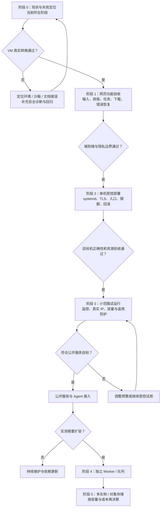

# 分阶段升级路线

基线：a558df7，2026-11-06。按交付条件推进，不给尚无容量数据的工作编造完成日期。

## 阶段 0：定位当前失败，建立可信基线

当前阻塞：VMware 页面上传 prompt.md 返回 CONVERTER_FAILED。WSL 成功不能代替目标环境成功。

交付内容：最小 Markdown 与失败文档的对照；doctor、沙箱探测、带 limit_exec 的真实任务验证；记录 Python、Pandoc、Bubblewrap、内核、安全策略和服务启动环境。

需区分普通宿主 CLI 成功、沙箱探测成功、真实受限转换成功三个条件。不得通过禁用隔离或无限放大内存来取得表面成功。受控诊断增加退出码、阶段和资源原因，不对公网暴露原始文稿/路径。

退出条件：在目标 VM 上同一部署方式可重复转换最小文档、中文、表格、公式和图片；prompt.md 若是内容导致，能给出明确错误而非只显示通用失败。

## 阶段 1：网页完整验收

当前已有：独立网页、八类排版编辑、JSON 配置导入导出、批量、图片、任务状态/取消/下载/删除、匿名会话与幂等。

补验：文件夹相对路径；粘贴正文不跨刷新保存；同 Cookie 任务恢复；网络重试；限额、失效会话、部分成功；Windows Word 最终效果与配置兼容。编号清理风险单独跟踪，警告不能替代修复方案。

退出条件：用户在 Windows 浏览器完整走通业务；下载 DOCX 实际打开；目标 VM 回归通过；确认网页副本升级时如何同步桌面编辑器和默认配置。

## 阶段 2：单机受控部署

交付：专用用户、数据目录、systemd 单实例、受控重启、固定依赖、TLS 与 Nginx 回环转发、备份/更新/回滚说明。参考 ../README.md 和 网页版迁移与验收.md；完整发布脚本与恢复演练尚待实现。

重点验收：同一任务在手动运行与 systemd 下均成功；OOM/超时/取消后无残留进程；入口超限拒绝；外网无法绕过入口访问 8000；磁盘预算和保留期生效。

退出条件：2 核 2G 实机记录 API、子进程及整服务峰值，确认 MemoryMax/CPUQuota；至少一次更新回滚演练；真实 IP 策略定稿或明确仅受控小范围使用。

## 阶段 3：试运行与公开服务

需要的指标：成功率按错误原因分组、排队等待时间、转换耗时、任务大小、CPU/RSS/OOM、私有数据字节、磁盘剩余、入口 413/429/5xx、取消耗时和过期清理滞后。

指标标签不使用正文、原始文件名、token 等高基数或敏感数据。日志采用必要的内部 ID，不保存整个请求体。

候选防护：入口 IP 限流、连接与上传时限、带宽预算；有证据再考虑 WAF/挑战/封禁。Cloudflare 是否接入取决于域名、网络与成本，不默认用户已选择。

公开条件：可信代理链不可伪造；多用户不会共用一个应用限流桶；生产 HTTPS Cookie；文档保留与诊断政策明确；压力测试与费用预算通过用户验收。

Agent 首批平台仍待用户确认。先提供 HTTP 契约与附件示例，不能假设所有平台都能上传 multipart 或下载二进制。

## 阶段 4：独立 Worker

仅在队列或进程故障域成为实际瓶颈时实施。API 只接收/查询，Worker 独立领取任务；保留同一 API 和所有权语义。

设计先行：原子领取、租约与心跳、崩溃恢复、取消信号、任务超时、幂等墓碑、一致的清理/下载规则、每 Worker 的 cgroup。先单机拆进程，再评估跨机器。

退出条件：任务不会重复领取或产生无主文件；API/Worker 单独重启可恢复；双 Worker 压测不突破总资源预算。

## 阶段 5：多实例与存储分离

候选：外部持久数据库、消息队列、对象存储、全局限流、独立产物下载。不能把 SQLite 工作目录放到共享网络盘就视为完成分布式部署。

保留任务归属、删除/过期和幂等语义；签名下载地址需防泄露、限时，不能变成永久公开链接。区域、备份、迁移和删除政策同步更新。

## 不纳入当前阶段的内容

账户、收费、长期 API Key、任意格式转换、任意外部资源抓取、无限并发和完整桌面远程文件系统。均需新需求和相应安全/成本评估。

## 当前更新与未来不停机迁移的区别

当前应采用停止新提交、排空运行任务、记录状态、短暂重启的受控更新。单实例 flock 与 API 内置执行器不支持两个版本直接共享数据目录并行工作；当前没有一键排空或蓝绿发布实现。

未来不停机需要先有独立 Worker、原子领取与租约、共享持久状态和产物、兼容 schema、相同会话语义、入口健康路由及切流。先兼容扩展数据结构，再部署应用与流量切换，最后收缩旧结构。不能恢复旧数据库备份抹掉发布后已受理的新任务。

优先补安全诊断，因为它直接支持当前失败定位；第一个按证据拆成独立进程的模块建议是任务执行器，用于隔离高资源消耗与故障域。是否实施仍由试运行的排队、P95、RSS/OOM 和成本指标触发。
