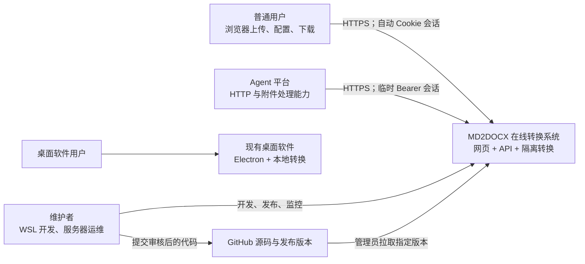
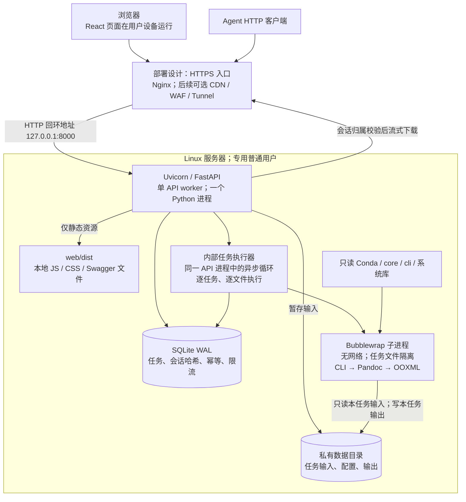
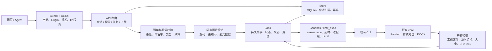
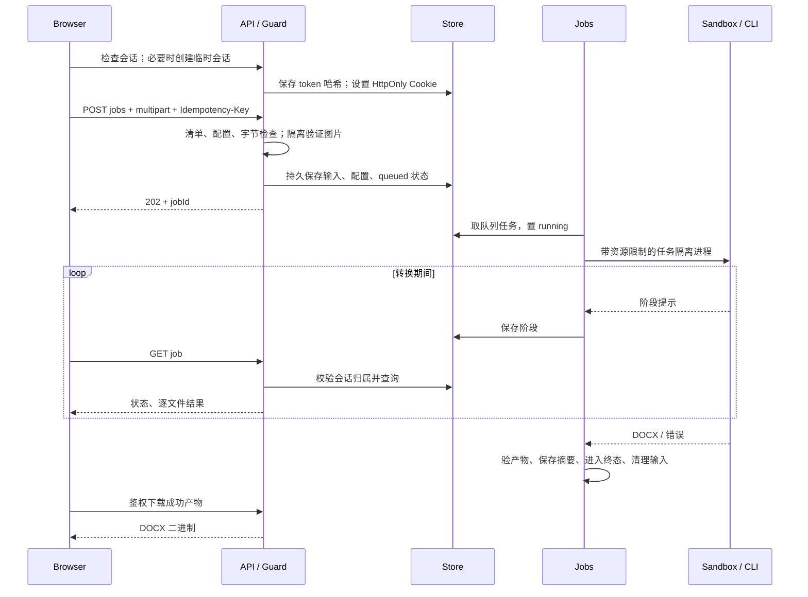
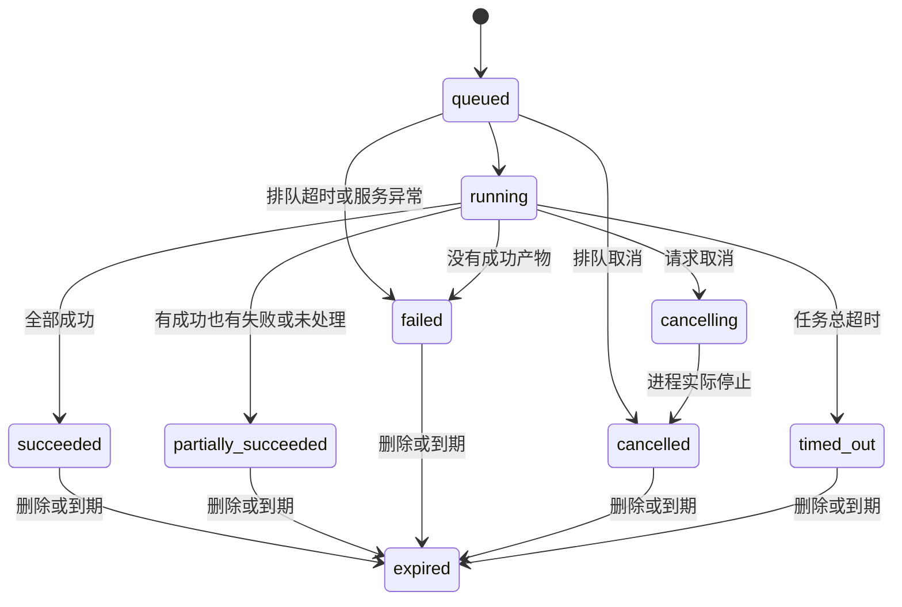

# MD2DOCX 架构梳理：C4

基线：2026-11-06，代码提交 a558df7。本文记录当前实现，同时单独标注部署设计和未来演进；图中的「容器」指 C4 的运行/存储单元，不表示使用 Docker。

## 1. 当前状态和边界

- 产品：免费、免登录的 Markdown → DOCX 网页，以及可被 Agent 调用的 HTTP API。
- 网页从桌面端复制必要样式和编辑器，存放 server/web，独立维护与构建；桌面端保持本地转换方式。
- 服务复用 core/cli 和 Pandoc，不复制转换引擎，不要求访问者安装环境。
- WSL 已有真实转换验证；VMware 已验证 Windows 网络访问和页面加载，但用户上传的 prompt.md 返回 CONVERTER_FAILED，根因未定。此项阻断生产验收。
- 正式公网入口、域名、TLS、真实 IP 处理、systemd 下的转换兼容性和 2 核 2G 容量尚未验收。

## 2. C1：系统上下文

桌面软件不依赖云端才能工作。在线系统不会根据 Markdown 中的链接联网抓图，不向第三方 Agent 平台主动推送文档。用户的文稿属于不可信输入，不构成执行命令或改变服务配置的指令。

## 3. C2：运行与存储单元

当前 WSL/VM 验证使用 HTTP 直连，没有图中的公网 HTTPS 入口。生产设计只开放入口端口，转换端口绑定回环地址。Node 仅用于构建，运行转换时不需要常驻 Node 服务。

图片解码也在单独的 Bubblewrap 子进程中执行，位于提交受理阶段；它与转换使用不同的时限和内存上限。图片验证锁只保证图片验证串行，不能据此宣称它不会与已有任务转换同时运行。

## 4. C3：服务组件与代码对应

| 层/职责 | 项目根目录下的文件 | 约束 |
| --- | --- | --- |
| 网页组件与交互 | server/web/src/App.jsx、components/ | 独立于 desktop，文本不作为 HTML 执行 |
| HTTP 适配 | server/web/src/api.js | 同源 Cookie；清单上传；幂等重试；下载检查 |
| Web/API 入口 | server/api/app.py | 只挂载 dist 公开资源；数据目录不可公开 |
| 兼容入口 | server/app.py、server/__main__.py | 保留 python -m server，默认回环地址 |
| 数据模型/校验 | server/models.py、validation.py | 服务端为最终校验方 |
| 调度/生命周期 | server/jobs.py | 单执行器；终态清理输入与配置 |
| 持久化 | server/store.py | state.sqlite3；WAL；单实例文件锁 |
| 沙箱/限额 | server/runner.py、limit_exec.py、image_guard.py | 不可关闭隔离来绕过错误 |
| 转换核心 | cli/、core/ | 沿用原实现与配置协议 2 |
| 部署 | server/scripts/、deploy/ | 安装与启用服务分开；模板须实机验收 |

服务层模块暂未全部移入子目录，避免无关重构影响隔离进程的挂载路径。api/ 和 web/ 已分离，并非宣称完成了所有模块的包结构升级。

## 5. C4：代码级关键协作与任务状态

C4 的第 4 层通常按需展示。这里给出关键运行调用关系，不人为为所有函数生成类图。

状态图省略服务停止/重启等异常边，精确状态与错误码以 API.md 和实现为准。expired 是存储生命周期状态，不意味着输出文件永久可恢复。

## 6. 信任边界与数据生命周期

| 数据 | 所在位置 | 生命周期与访问 |
| --- | --- | --- |
| Cookie / Bearer token | 客户端；服务只存哈希 | 默认会话 48 小时；令牌不进 URL/日志 |
| 网页配置和最近任务 ID | 浏览器 localStorage | 不含正文；不会自动跨设备同步 |
| 正文、图片、有效配置 | 私有任务工作区 | 任务终态后清理；异常退出后的清理须测试 |
| DOCX | 私有 outputs | 默认保留 24 小时；同会话下载、可主动删除 |
| 任务元数据和幂等墓碑 | SQLite | 与结果文件保留并非同一概念，按清理实现执行 |
| 运维备份 | 运维指定私有目录 | 会额外延长数据实际保留时间，应有独立删除政策 |

防护分为入口层（TLS、连接、带宽）、应用层（鉴权、校验、限额）、执行层（namespace、rlimit、systemd）三层。任何一层都不能替代另外两层；CORS 也不是用户身份认证。

## 7. 部署与性能的已知限制

1. API 与执行器共进程，不能增加 Uvicorn workers 来直接扩容；同数据目录第二实例会被锁拒绝。
2. Uvicorn 当前 proxy_headers=False。Nginx 转发后，应用以 127.0.0.1 为连接来源，当前 IP 限流会聚合所有用户。
3. readyz 只做隔离运行环境探测，未覆盖 limit_exec 下的真实任务；200 不等于可完成任意转换。
4. 当前不保留原始转换 stderr；CONVERTER_FAILED 定位能力不足，需增补受控诊断，禁止把原文和主机路径直接公开。
5. 进程虚拟地址空间默认 1 GiB，systemd 整服务 MemoryMax 模板为 768M。两者统计口径不同；不能据此推导安全并发数，需观察 RSS、OOM 和实机峰值。
6. 默认读请求限流也涵盖静态资源与轮询，需在公开使用前评估入口、应用限流分工。

相关文档：[ADR](ADR决策记录.md)、[升级路线](分阶段升级路线.md)、[服务部署说明](../README.md)、[网页迁移与验收](网页版迁移与验收.md)。

## 8. 汇报核对补充（2026-11-06）

- `worker.js` 仅转发 `env.ASSETS.fetch`，`wrangler.toml` 指向 website；工作流的 paths 也只覆盖官网。下载官网、桌面软件、在线转换属于三条不同链路。
- 落库顺序：有界请求体在内存解析，写 staging，隔离验证图片，目录 rename 到 jobs/jobId，再执行 SQLite insert。目录切换与数据库提交不是同一事务。
- `max_queue=8` 实际统计 queued/running/cancelling 活跃任务总数，不是额外 8 个排队位置。
- 轮询间隔约 1.6 秒，假设五个持续活跃页面约 188 次读取/分钟。当前读请求桶上限 180/分钟，若经代理聚合为同一 remote，会产生限流风险。该计算是模型，并非实测容量。
- 数据清理是终态后尝试删除，部分调用忽略 OSError，故不能把逻辑状态等同于物理字节删除保证。
- C4、流程和升级图已整理到 presentation/diagrams，PPT 中图形也可编辑。图由代码反推并交叉核对，团队人工签核仍待完成。
